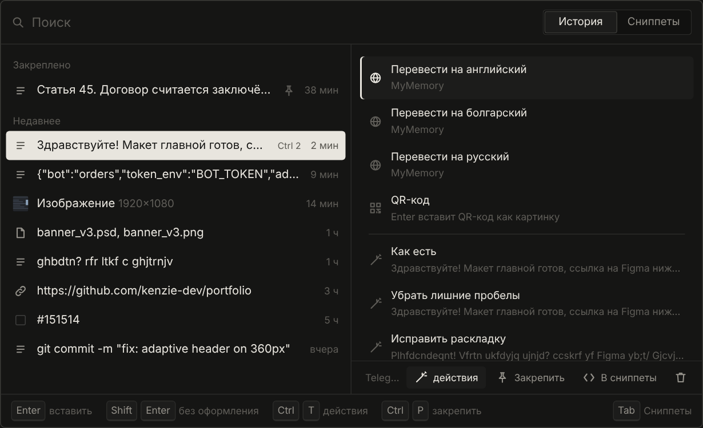
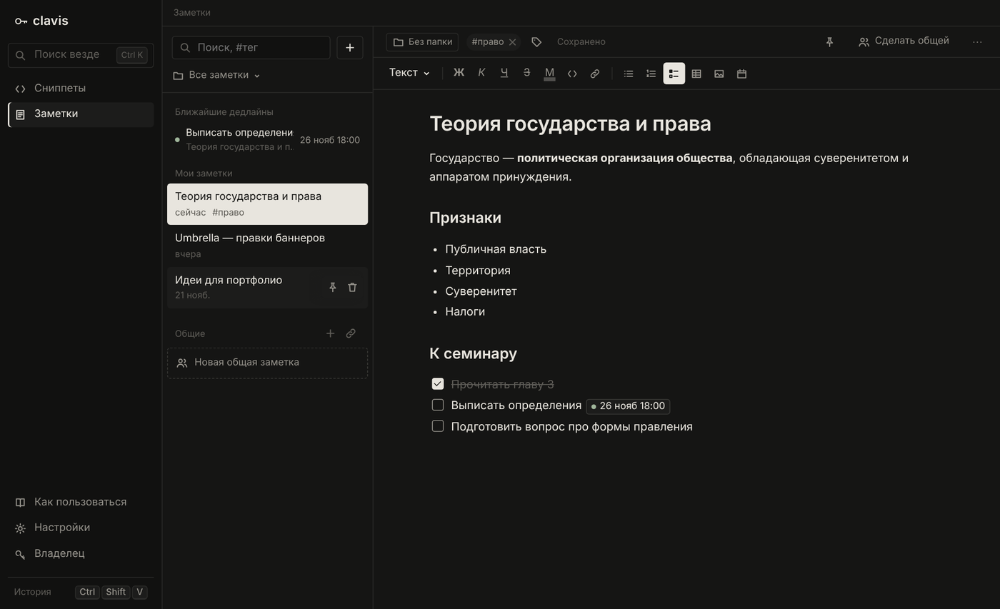
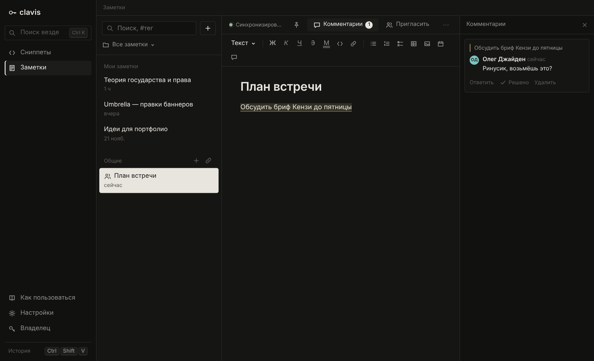
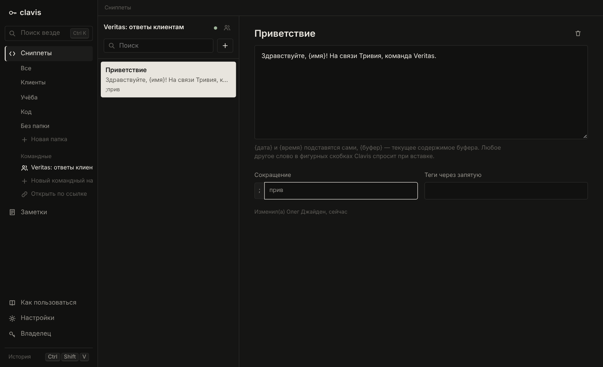
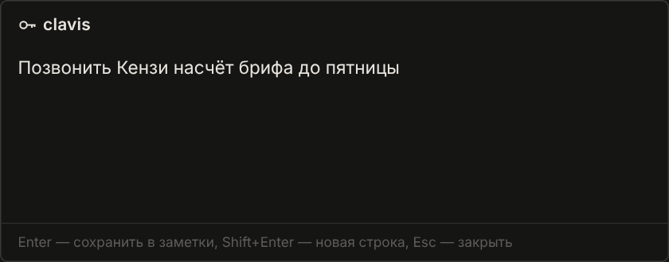
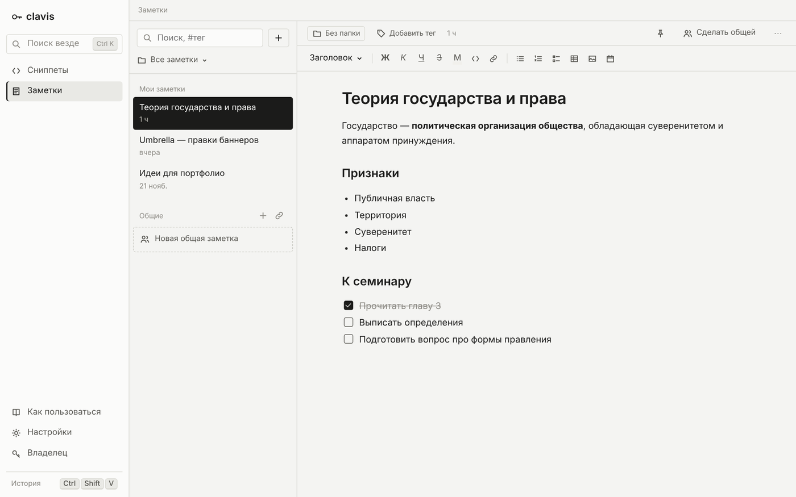

# Clavis

Буфер обмена, сниппеты и заметки для Windows в одном месте. Всё хранится на вашем компьютере в зашифрованном виде.

Clavis помнит всё, что вы копировали, и вставляет нужное по сочетанию клавиш. Часто повторяемые ответы превращаются в сниппеты с сокращениями: набрали `;подп`, получили подпись. Заметки пишутся как в Word, а общими можно работать вместе с командой в реальном времени.

**[Скачать последнюю версию](https://github.com/Minorq5/Clavis/releases/latest)** — файл `Clavis_x.x.x_x64-setup.exe`. Windows 10 и 11. Для входа нужен код доступа: его выдаёт владелец, запросить можно прямо из программы.

## Что умеет

- **История буфера.** Текст, картинки и файлы. `Ctrl+Shift+V` открывает окно рядом с курсором, Enter вставляет.
- **Действия с записью.** Посчитать `200 + 15%`, перевести, сократить ссылку, сделать QR-код, достать текст из скриншота, исправить раскладку.
- **Сниппеты** с папками, тегами, полями `{имя}` и сокращениями, которые работают в любой программе. Статистика показывает, какими сниппетами вы не пользуетесь.
- **Заметки** с папками, тегами, шаблонами, ссылками между заметками, дедлайнами с напоминанием, учётом времени, историей версий и корзиной. Экспорт в Word, PDF и Markdown.
- **Секретные заметки** под отдельным паролем.
- **Быстрая заметка** `Ctrl+Alt+N` из любой программы: записали мысль, нажали Enter.
- **Общие заметки и командные сниппеты.** Видны курсоры соавторов, есть комментарии и упоминания `@имя`.
- **Поиск везде** по `Ctrl+K`, светлая и тёмная тема, вход через Windows Hello, резервная копия одним файлом, автообновление.

## Для чего это удобно

- Отвечать клиентам готовыми фразами, не держа их в отдельном файле.
- Конспектировать лекции и не терять сроки сдачи.
- Вести общие тексты команды: шаблоны, правила, фразы для RP.
- Достать то, что скопировали час назад и уже перезаписали.

## Данные

Заметки, сниппеты и история не покидают компьютер в открытом виде. Сервер нужен только для кодов доступа и общих заметок и видит их лишь в зашифрованном виде. Подробно: [Политика конфиденциальности](docs/legal/privacy.ru.md), [Условия использования](docs/legal/terms.ru.md). In English: [Privacy Policy](docs/legal/privacy.en.md), [Terms of Use](docs/legal/terms.en.md).

## Для разработчиков

Сборка, устройство шифрования и сервер описаны в [docs/development.md](docs/development.md).

## Лицензия

MIT
